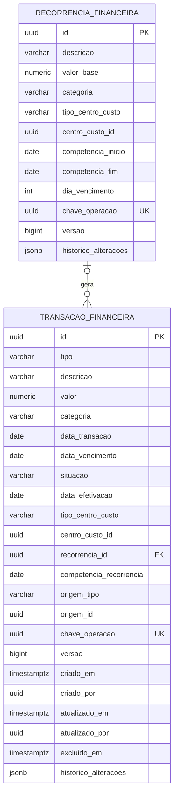

# Spec: Financeiro Essencial — FIN-001

> feature: financeiro-essencial
> status: rascunho

## Objetivo e escopo

Permitir ao produtor cadastrar contas fixas uma vez, registrar despesas avulsas e receitas, confirmar operações integrais e consultar resultados mensais e anuais. FIN-001 definiu os contratos; FIN-002.1 e FIN-002.2 implementam domínio e persistência. Casos de uso, API, recorrência e demais entregas permanecem planejados. O status SDD permanece rascunho porque os critérios funcionais integrais ainda não têm implementação e prova completa.

O MVP abrange lançamentos manuais, recorrências mensais de despesas, duas situações operacionais, vencimentos opcionais, histórico e correções. Não cria exercícios separados nem um saldo bancário.

## Implementação atual

- V1 cria `transacao_financeira`: UUID, tipo, `data_transacao`, `NUMERIC(12,2)`, categoria e centro de custo polimórfico. Não há descrição, pagamento, recorrência nem auditoria. V2–V11 não evoluem essa tabela.
- `LancamentoFinanceiro` e sua persistência salvam e recuperam receitas e despesas com todos os campos financeiros. `DespesaRepository` atende compras e consultas de despesas; o mapper preserva a descrição e novos lançamentos operacionais iniciam PENDENTE.
- `DespesaController` expõe GET paginado; o método de criação não possui `@PostMapping`. DELETE `/{id}/estornar` retorna 501. Não documentar essas operações como disponíveis.
- Somatório, paginação e consultas da porta Despesa filtram DESPESA. Consultas por lote e animal também filtram o tipo do centro, evitando misturar receitas ou centros de tipos distintos.
- Compra operacional com valor gera uma despesa COMPRA_ANIMAL/ANIMAL na mesma transação; sem valor não gera. Os testes de `RegistrarCompraAnimalUseCaseTest` preservam esse contrato. Aquisição histórica (V10, cadastro inicial) não gera despesa.
- `ExcluirAnimalUseCase` pode remover despesas iniciais COMPRA_ANIMAL por `DespesaRepository.excluirPorId`, hoje exclusão física. A evolução deve preservar o fluxo pecuário permitido e registrar a exclusão financeira logicamente, com motivo da operação e autor, na mesma transação. O centro polimórfico histórico pode apontar para animal depois excluído; sua validade é exigida no cadastro ou alteração do vínculo, sem apagar a auditoria histórica.
- Venda atual é individual, registrada em `venda_animal` (V5), marca animal VENDIDO e limpa seu lote; não cria receita financeira. `VendaController` recebe um animal e o usecase retorna o ID do animal, apesar do nome local vendaId. Não alterar esse contrato nesta entrega.
- Custo por arroba e desembolso por cabeça/mês usam despesas por ocorrência; margem bruta/hectare usa vendas pecuárias e essas despesas. São indicadores produtivos, diferentes do novo resultado financeiro por efetivação.

Premissa confirmada pelo usuário em 2026-10-13: o financeiro começa do zero, sem transações antigas. A V12 em desenvolvimento exige descrição e situação de todos os lançamentos. Não há marcador, leitura ou classificação especial de legado financeiro.

## Histórias e critérios de aceitação

### US-700 — Registrar receitas e despesas
Como produtor, quero registrar gastos e receitas para organizar minhas obrigações e entradas.

#### AC-700 — Lançamento válido
- **Dado** descrição não vazia, valor positivo com até duas casas decimais, categoria compatível e data de referência
- **Quando** registrar receita ou despesa pendente
- **Então** persistirá um lançamento com UUID, sem data efetiva, e descrição preservada após leitura.

#### AC-701 — Invariantes e centros de custo
- **Dado** valor nulo, zero, negativo, maior que 9.999.999.999,99, fração de centavo, categoria incompatível ou referência de centro inexistente
- **Quando** registrar ou corrigir
- **Então** rejeitará sem persistir; GERAL não terá referência e ANIMAL, LOTE ou PASTO exigirão referência válida.

#### AC-702 — Reenvio sem duplicação
- **Dado** uma chave de operação já utilizada
- **Quando** repetir o mesmo cadastro, inclusive concorrentemente
- **Então** retornará o mesmo lançamento; conteúdo diferente com a mesma chave será conflito, enquanto chaves distintas permitirão despesas legitimamente iguais.

### US-701 — Confirmar pagamento ou recebimento
Como produtor, quero confirmar o movimento integral para distinguir obrigações de dinheiro movimentado.

#### AC-703 — Efetivação integral
- **Dado** um lançamento pendente de 100,00
- **Quando** confirmar a operação com data efetiva não futura
- **Então** ficará EFETIVADO por 100,00, exibindo Pago para despesa ou Recebido para receita; confirmação não aceitará valor parcial.

#### AC-704 — Repetição e tipo
- **Dado** um lançamento já efetivado ou uma receita enviada à ação de pagar
- **Quando** confirmar novamente
- **Então** a mesma data será resposta idempotente sem nova movimentação; data diferente ou ação incompatível retornará conflito.

### US-702 — Gerar contas fixas mensais
Como produtor, quero cadastrar salário, energia, internet e água uma vez para obter contas independentes por mês.

#### AC-705 — Geração independente
- **Dado** recorrência de despesa vigente entre janeiro e março de 2026, valor base 200,00
- **Quando** gerar esse intervalo
- **Então** criará três despesas pendentes, uma por competência; corrigir fevereiro para 230,00 ou pagá-lo não alterará janeiro, março ou a recorrência.

#### AC-706 — Unicidade e exclusão
- **Dado** mês já gerado, inclusive com lançamento excluído logicamente
- **Quando** repetir ou concorrer na geração
- **Então** não criará outro lançamento para a mesma recorrência e competência; a exclusão não permitirá recriação automática.

#### AC-707 — Limites de calendário e encerramento
- **Dado** vencimento no dia 31 e recorrência iniciada em janeiro e encerrada em fevereiro de 2028
- **Quando** gerar janeiro a março
- **Então** vencerá em 31/01 e 29/02, não gerará março e preservará os lançamentos já existentes.

### US-703 — Consultar mês, ano e pendências
Como produtor, quero comparar o que paguei e recebi e acompanhar contas ainda abertas.

#### AC-708 — Resultado por efetivação
- **Dado** despesa referenciada em dezembro de 2026 paga em janeiro de 2027 por 100,00, receita recebida em janeiro por 300,00 e despesa pendente de 50,00
- **Quando** consultar janeiro de 2027 ou o ano de 2027
- **Então** terá receitas recebidas 300,00, despesas pagas 100,00 e resultado 200,00; a pendência não reduzirá o resultado e a despesa paga não comporá o caixa de dezembro.

#### AC-709 — Pendências e vencidos
- **Dado** obrigações pendentes com referência no período, uma vencida ontem, outra vencendo hoje e outra sem vencimento
- **Quando** consultar pendências na data de hoje
- **Então** todas integrarão pendências, apenas a primeira será vencida e obrigações antigas poderão ser consultadas sem restringir a referência ao mês atual.

#### AC-710 — Histórico e períodos
- **Dado** lançamentos em 2026, 2027 e 2028
- **Quando** filtrar por referência ou efetivação, ano e mês opcional
- **Então** usará o primeiro e último dia do período inclusivamente, paginação estável e filtros por tipo, categoria, situação e centro; mês inválido será rejeitado e período sem registros terá totais zero.

### US-704 — Corrigir e excluir com rastreabilidade
Como produtor, quero corrigir enganos sem apagar a evidência das alterações.

#### AC-711 — Auditoria e concorrência
- **Dado** lançamento pendente ou efetivado e versão vigente
- **Quando** corrigir valor, descrição, categoria ou datas, ou excluir com motivo
- **Então** registrará autor autenticado, instante, motivo e valores anteriores/novos, excluirá logicamente e recalculará os totais; versão desatualizada será conflito e nada será perdido silenciosamente.

### US-705 — Inicializar o financeiro e preservar operações pecuárias
Como produtor, quero iniciar o financeiro com dados completos e preservar as operações pecuárias sem duplicações.

#### AC-712 — Inicialização sem transações antigas
- **Dado** banco sem transações financeiras preexistentes
- **Quando** aplicar as migrations e persistir novos lançamentos
- **Então** a tabela receberá os campos financeiros sem criar lançamentos artificiais; descrição e situação serão obrigatórias e a situação será consistente com a data de efetivação, sem tratamento especial de legado.

#### AC-713 — Isolamento das consultas de despesas
- **Dado** despesas e receitas na mesma tabela, centros de tipos diferentes e registros excluídos
- **Quando** consultar DespesaRepository e indicadores produtivos
- **Então** retornará apenas despesas não excluídas e centros do tipo correto, por data de referência independentemente da situação, usando os valores dos lançamentos de despesas do período.

#### AC-714 — Compra e aquisição histórica
- **Dado** compra operacional com valor ou cadastro de aquisição histórica
- **Quando** executar os respectivos fluxos
- **Então** compra gerará exatamente uma despesa vinculada ao animal, sem presumir pagamento, e cadastro histórico não gerará lançamento financeiro; compra sem valor continuará sem despesa.

#### AC-715 — Venda separada no MVP
- **Dado** venda individual atual e receita manual de venda de animais
- **Quando** registrar cada operação
- **Então** a venda continuará sem receita automática, a receita manual não alterará animais nem lotes, e indicadores de venda não somarão novamente essa receita manual.

## Regras de negócio e datas

Tipo financeiro: RECEITA ou DESPESA. Situação operacional: PENDENTE ou EFETIVADO. Data de referência identifica a ocorrência/competência e mantém o nome físico `data_transacao`; `data_efetivacao` identifica dinheiro movimentado. Vencimento é opcional e pode preceder ou suceder a referência, sem presumir pagamento. Efetivação exige data conhecida, não futura; antecipações são permitidas. Datas de referência futuras são permitidas para planejamento.

Novos lançamentos exigem situação; PENDENTE exige data efetiva nula, EFETIVADO exige data efetiva preenchida. Cadastro já pago/recebido é permitido com ambas as informações. Não há pagamento parcial, parcela, juros calculados ou terceiro estado operacional. Descrição e situação ausentes não são aceitas; o financeiro começa sem registros preexistentes.

Correção pode desfazer confirmação indevida para PENDENTE limpando a data efetiva, com motivo e histórico. Tipo e identidade da origem são imutáveis: erro de tipo exige exclusão lógica e novo registro. Não gerar receita/despesa compensatória para simular uma correção. Exclusão sai dos totais e permanece acessível no histórico auditável. Rastreabilidade básica retém alterações nesta própria tabela em uma lista JSONB append-only escrita pelo servidor; não é um livro contábil nem exige tabela contábil adicional.

Categorias de despesas preservadas: NUTRICAO, SANIDADE, PASTAGEM, MAO_DE_OBRA, MANUTENCAO, IMPOSTOS, COMPRA_ANIMAL, DIVERSOS. Acrescentar ENERGIA, INTERNET, AGUA, COMBUSTIVEL e SERVICOS. Categorias de receita em enum próprio: VENDA_ANIMAIS, VENDA_LEITE, VENDA_PRODUTOS, PRESTACAO_SERVICOS, OUTRAS_RECEITAS. Persistir nomes em VARCHAR, não enum nativo PostgreSQL. Nenhum cadastro de categorias.

Centros de custo preservam `TipoDeCusto` (GERAL, ANIMAL, LOTE, PASTO) e `centro_custo_id`; não usar esse UUID como origem operacional. O tipo do centro é obrigatório para todos os lançamentos; GERAL não tem referência e os demais centros exigem referência. O comentário FAZENDA da V1 não define uma opção do domínio.

Recorrência contém descrição, valor base, categoria de despesa, centro, mês inicial, mês final opcional e dia de vencimento 1–31. Competências são datas no primeiro dia do mês; vencimento usa o menor entre dia configurado e último dia do mês. Referência do lançamento gerado é a competência. Gerar somente meses solicitados dentro da vigência, sem retroagir antes do início nem gerar todos os exercícios. Encerrar alterando mês final; alteração de modelo só vale para competências ainda não geradas e é auditada. Se precisar de novo valor a partir de competência específica, encerrar o modelo e criar outro; não alterar lançamentos existentes. Sem scheduler e sem receitas recorrentes no MVP.

A consulta HTTP GET não grava. Ao abrir mês/ano, o frontend chama geração explícita idempotente antes de consultar lista/resumo. Falha de geração deve aparecer ao usuário, sem exibir resumo como completo.

## DER proposto (futuro)



Duas tabelas financeiras; centros polimórficos e origem opcional não são FKs fictícias. Recorrência também terá criado/atualizado em/por, omitidos do desenho para legibilidade. Histórico guarda ação, motivo, autor, instante e snapshot antes/depois.

Restrições futuras: valor positivo e precisão 12,2; tipo/categoria compatíveis; consistência situação/data; descrição e situação obrigatórias; par recorrência/competência completo; UNIQUE(recorrencia_id, competencia_recorrencia) incluindo excluídos; UNIQUE(chave_operacao) para reenvios manuais; UNIQUE(origem_tipo, origem_id, tipo) quando origem informada, incluindo excluídos. Criar índices por referência, efetivação, pendências/vencimento e centro; não usar apenas verificação prévia em memória para unicidade. Concorrência usa versão e transação, com recuperação do registro existente após conflito de unicidade.

## Casos de uso e contratos REST propostos

Core concentra invariantes e enums, usecase coordena transações e portas, infra implementa persistência/mappers, application valida payload e delega. Manter `DespesaRepository` como porta compatível e introduzir apenas a porta de lançamentos e a de recorrências necessárias. Evitar entidade JPA duplicada divergente para a mesma tabela; evoluir o mapeamento existente e adaptar a visão Despesa.

Prefixo novo `/api/v1/financeiro`; JSON camelCase, UUID e datas ISO `YYYY-MM-DD`, valores decimais em reais. Segurança JWT e padrão global de erros existente são preservados, sem detalhes internos. Respostas de lista usam `Pagina<T>` com os campos existentes `conteudo`, `numeroPagina`, `tamanhoPagina`, `totalElementos` e `totalPaginas`.

| Caso de uso | Contrato | Resultado |
|---|---|---|
| RegistrarReceita / RegistrarDespesa | POST `/lancamentos` | 201, Location e lançamento; repetição idempotente 200 |
| CadastrarDespesaRecorrente | POST `/recorrencias` | 201, recorrência |
| ConsultarRecorrencias | GET `/recorrencias?pagina=0&tamanho=50` | 200, Pagina de modelos, inclusive encerrados |
| GerarLancamentosMensais | POST `/recorrencias/gerar` com `{ano, mes?}` | 200, quantidade criados/existentes |
| ConfirmarPagamento | POST `/lancamentos/{id}/pagar` com `{dataEfetivacao, versao}` | 200, lançamento |
| ConfirmarRecebimento | POST `/lancamentos/{id}/receber` com mesmo contrato | 200, lançamento |
| ConsultarLancamentosPorPeriodo | GET `/lancamentos?ano=2027&mes=1&baseData=REFERENCIA&pagina=0&tamanho=50` | 200, Pagina |
| ConsultarPendencias | GET `/pendencias?ano=2027&mes=1&vencidas=true` | 200, Pagina; ano/mês opcionais para todas as abertas |
| ConsultarResumoFinanceiro | GET `/resumo?ano=2027&mes=1` | 200, totais e período |
| CorrigirLancamento | PATCH `/lancamentos/{id}` | 200, lançamento |
| ExcluirLancamento | DELETE `/lancamentos/{id}` com `{motivo, versao}` | 204, exclusão lógica |
| ConsultarHistorico | GET `/lancamentos/{id}/historico` | 200, alterações, inclusive de excluídos |
| Corrigir/EncerrarRecorrencia | PATCH `/recorrencias/{id}` com motivo e versão | 200, modelo; sem modificar meses gerados |

Cadastro: `{chaveOperacao, tipo, descricao, valor, categoria, dataReferencia, dataVencimento?, situacao, dataEfetivacao?, tipoDeCusto, referenciaId?}`. `referenciaId` continua significando centro de custo. Origem não é livremente definida pelo cliente manual: servidor atribui em fluxos operacionais; receitas manuais têm origem ausente. Resposta acrescenta id, versão, recorrência/competência, origem e auditoria resumida. Recorrência recebe os campos de modelo e chaveOperacao, com unicidade também na tabela de recorrências para evitar duplicar o modelo por reenvio.

Cadastro de recorrência: `{chaveOperacao, descricao, valorBase, categoria, tipoDeCusto, referenciaId?, competenciaInicio, competenciaFim?, diaVencimento}`. Competências usam `YYYY-MM-01`; fim não pode preceder início. O tipo é sempre DESPESA e os meses gerados começam PENDENTE. Reenvio do mesmo modelo com a mesma chave retorna 200; mudança de conteúdo com a mesma chave retorna 409. Geração aceita ano com mês opcional: sem mês processa as doze competências do ano, limitadas à vigência, em uma transação; falha não deixa geração parcial. O intervalo janeiro–março dos critérios pode ser exercitado por três chamadas mensais.

Exemplo de cadastro manual:

```json
{
  "chaveOperacao": "ea109355-8d69-47f0-92bd-a7be2d317a64",
  "tipo": "DESPESA",
  "descricao": "Energia de janeiro",
  "valor": 200.00,
  "categoria": "ENERGIA",
  "dataReferencia": "2027-01-01",
  "dataVencimento": "2027-01-20",
  "situacao": "PENDENTE",
  "tipoDeCusto": "GERAL"
}
```

Correções não alteram chave de operação, vínculo de recorrência ou competência geradora. Lançamento excluído rejeita novas correções/confirmações com 409. A confirmação repetida com a mesma data retorna o registro atual mesmo se a versão enviada for anterior; qualquer outra mutação exige a versão vigente. A chave de cadastro identifica a requisição original: comparação de reenvio considera seu conteúdo original, preservado na auditoria, mesmo após correções.

PATCH aceita somente campos corrigíveis, motivo obrigatório e versão; campo ausente preserva, null limpa campo opcional. Efetivado exige data real informada. Exclusão repetida retorna 204 sem acrescentar evento duplicado. Recorrências não são removidas fisicamente.

GET aceita filtros opcionais tipo, categoria, situacao, tipoDeCusto, referenciaId; `baseData` é REFERENCIA (padrão) ou EFETIVACAO. Lista normal exclui excluídos, com filtro explícito para histórico. Ordenação data selecionada e id; pendências por vencimento (nulos por último) e id. Ano obrigatório nas consultas por período, mês 1–12 opcional; resumo anual soma movimentos do ano, não saldos mensais acumulados. Tamanho 1–100 e página não negativa.

Resumo: `{inicio, fim, receitasRecebidas, despesasPagas, resultado, receitasPendentes, despesasPendentes, receitasVencidas, despesasVencidas}`. Recebidos/pagos por efetivação; pendentes e vencidos do resumo por referência no período e situação atual. `/pendencias` sem ano encontra também atrasos de exercícios anteriores. Vencido significa pendente e vencimento anterior à data de consulta da fazenda; vencimento hoje não está atrasado. Resumo não reconstrói posição histórica de pendências em uma data passada.

Erros: 400 payload/invariantes/filtros inválidos, 404 recurso inexistente, 409 versão/chave/operação conflitante; autenticação segue 401/403 existentes. GETs nunca geram lançamentos. Preservar GET `/api/v1/despesas` e seu formato; manter estorno 501 até contrato específico de evolução, sem transformar silenciosamente estorno em exclusão. POST financeiro é novo, não alegar compatibilidade com rota de cadastro atualmente inexistente.

## Inicialização do banco e integração com as operações

1. O financeiro começa sem transações antigas, conforme confirmação explícita do usuário. Não implementar backfill, marcador ou classificação de legado financeiro.
2. Novas migrations após V11 adicionam os campos financeiros à tabela existente, mantendo UUID e `data_transacao`. Descrição e situação são obrigatórias desde a inicialização; a V12 ainda não versionada reflete essa premissa.
3. A inicialização não cria lançamentos nem presume pagamentos; a data efetiva é informada somente quando a situação é EFETIVADO.
4. Novos lançamentos exigem descrição e situação. Evoluir adaptador de Despesa mantendo assinaturas e sem sobrescrever situação/auditoria ao salvar pela visão Despesa. Compra operacional futura grava PENDENTE e origem COMPRA_ANIMAL/id do animal, pois o comando atual não comprova pagamento.
5. Antes de habilitar receita, filtrar tipo DESPESA em soma/paginação e tipo LOTE em busca por lote; excluir logicamente sem incluir em indicadores. Consultar despesas por referência e não filtrar somente EFETIVADO: mudança de semântica dos indicadores é tarefa separada. Receitas manuais não entram novamente na margem calculada a partir de vendas.
6. Nova migration de recorrência, FK sem cascade destrutivo e constraints/índices. Preservar unicidade mesmo após exclusão. Testar inicialização em banco vazio em PostgreSQL, além de mapeamento em H2.

Também cobrir a exclusão de animal com despesa inicial: a porta Despesa atende as operações de compra e consulta, mas a implementação financeira deve preservar a linha e registrar a exclusão com contexto auditável do caso de uso. Exclusões lógicas deixam de aparecer em consultas operacionais da porta. Não criar FK de centro polimórfico que impeça o fluxo existente ou remova o histórico por cascade.

A V12 foi criada na FIN-002.2; migrations anteriores permanecem imutáveis.

## Integração futura com Vendas (outra sprint)

Propor `venda` como cabeçalho da negociação (comprador, data, valor total) e evoluir `venda_animal` como itens com `venda_id` e `lote_origem_id` capturado antes da baixa. Preservar campos de modalidade e cálculo individual. A modelagem será definida na sprint Vendas para um sistema em desenvolvimento, sem conversão de dados antigos de produção.

A futura operação selecionará um animal, todos os ativos de um lote ou UUIDs individuais de vários lotes; rejeitará seleção vazia, UUID repetido e qualquer animal não ativo. Validação e mudança de status sob transação/controle de concorrência: todos ou nenhum. Não encerra lote automaticamente. Negociação gera uma receita por `origem_tipo=VENDA` e `origem_id=venda.id`, protegida por unicidade, nunca por animal. Receita pode ser PENDENTE ou EFETIVADO com data comprovada.

Não ligar receita manual automaticamente por categoria/data/valor. A integração atribuirá vínculo de origem explícito às receitas que criar e evitará uma segunda receita para a mesma negociação. Correções de receitas vinculadas serão coordenadas pela operação de origem; o contrato dessa coordenação e reversão de venda pertence à sprint Vendas.

## Suposições

| ID | Suposição | Status | Evidência/impacto |
|---|---|---|---|
| ASM-700 | Data de hoje segue o calendário da fazenda em America/Bahia. | confirmada | Padrão do plano aprovado; usar relógio controlável nos testes de vencimento. |
| ASM-701 | Histórico JSONB na própria linha é suficiente para rastreabilidade básica. | confirmada | Escolha explícita do produtor nesta FIN-001; eventos escritos exclusivamente pelo servidor. |

Decisão atualizada pelo usuário em 2026-10-13: não existem transações financeiras antigas. O tratamento de legado proposto na FIN-001 foi retirado do escopo; todos os lançamentos exigem descrição e situação.

## Perguntas em aberto

| ID | Pergunta | Status | Encaminhamento |
|---|---|---|---|
| Q-700 | Existem transações financeiras antigas a migrar? | respondida | Usuário confirmou em 2026-10-13 que não existem registros antigos e que o financeiro começa do zero. |

## Fora do escopo

Implementação nesta FIN-001; vendas múltiplas e integração automática (sprint Vendas); parcelas e pagamentos parciais; contas e conciliação bancária; rateios complexos; contabilidade formal; custos individuais avançados; rentabilidade complexa; Excel; upload de comprovantes; agendadores; recorrência de receitas.

## Definição de pronto e validação futura

FIN-001 entrega spec, tarefas e documentação de produto revisáveis. Os critérios AC-700–AC-715 são compromissos futuros: cada um exigirá teste com `@spec:AC-xxx`, no domínio, usecase, MockMvc ou persistência conforme camada. Nenhum teste será criado ou marcado como PASS nesta tarefa documental. Audit pode informar critérios sem testes/provas e perguntas abertas; isso não significa implementação concluída. FIN-006 só fecha a feature com harness e gate SDD executados e resultados registrados.
